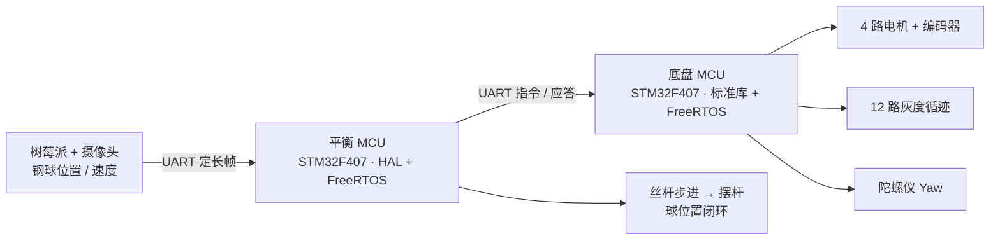

# 2026 全国大学生电子设计竞赛（赛区赛）H 题 —— 车载平衡滚球运动控制系统

**成绩**：广东省一等奖　|　**我的角色**：电控手，负责底盘 MCU 与平衡 MCU 的全部代码

## 题目要求（简述）

小车沿黑色环形线循迹行驶，行驶过程中通过丝杆摆杆机构把钢球稳定在摆杆中心或任意指定位置。核心指标：一圈不超过 20s 且停车误差不超过 2cm；钢球往返 ±5cm 用时不超过 5s、误差不超过 1cm；A→B 段不超过 8s 且钢球稳定在中心 ±1cm。

## 系统架构

- **底盘 MCU（`chassis-mcu#2/`）**：STM32F407 + 标准库 + FreeRTOS。TIM6 200Hz 硬实时中断中完成编码器测速、里程累计、循迹加权偏差 P 控制与加减速规划；融合陀螺仪 Yaw 做提前停车判定；用路径状态机（直线定距 / 差速转弯 / 定速循迹）串起整圈、AB 段、慢速圈等比赛流程。
- **平衡 MCU（`balance-mcu#1/`）**：STM32F407 + HAL + STM32CubeMX + FreeRTOS（CMSIS-OS v2）。接收树莓派视觉给出的钢球位置与速度定长帧（帧头 / 帧尾 + CRC 校验），做一阶低通滤波后，用增量式 PID（积分分离、微分低通、死区、输出限幅）解算摆杆目标角度，再经丝杆步进闭环稳定钢球，支持 ±5cm 指定位置与稳定判定。
- 双主控通过 UART 指令与应答通信；比赛流程由按键模式选择与状态机（待机 / 运行 / 完成）管理。

## 目录说明

两个工程都是完整工程，可直接编译。

### `chassis-mcu#2/`（底盘 MCU，标准库 + FreeRTOS）

| 路径 | 内容 |
| --- | --- |
| `User/` | 主程序、FreeRTOS 配置、中断与标准库配置 |
| `hardware/DSP/` | 自写驱动：`Encoder` 编码器、`Gray` 灰度循迹、`PID`、`Motor`、`PWM`、`Serial`、`Servo`、`HWT101` 陀螺仪、`Key`、`LED` |
| `hardware/Emm_V5/`、`hardware/OLED/`、`hardware/SYSTEM/`、`hardware/TFT/` | 步进电机协议驱动、显示驱动、系统层 |
| `FreeRTOS/`、`Libraries/` | FreeRTOS 内核与 STM32F4 标准库（厂商代码） |
| `Project/RVMDK（uv5）/` | Keil MDK5 工程文件 |

### `balance-mcu#1/`（平衡 MCU，HAL + CubeMX + FreeRTOS）

| 路径 | 内容 |
| --- | --- |
| `Core/` | CubeMX 生成的外设初始化（CAN、DMA、TIM、USART、GPIO）与 FreeRTOS 任务创建 |
| `RTOS_APP/` | 任务实现：`Main_task`（流程与状态机）、`Chassis_task`（底盘指令）、`Output_task`（输出执行）、`Tower_task`（摆杆与球位置 PID）、`UART_RX_Task`（视觉帧接收） |
| `BSP/` | 板级驱动：步进电机、云台电机（CAN）、IMU、舵机、串口、OLED、串口屏、OPS 模块 |
| `Support/` | CRC8 / CRC16 校验 |
| `Drivers/`、`Middlewares/` | STM32F4 HAL 与 FreeRTOS（厂商代码） |
| `MDK-ARM/` | Keil MDK5 工程文件与启动文件 |
| `工训test.ioc` | STM32CubeMX 配置 |

`docs/` 是赛前架构方案探索与比较（系统拓扑、球控方案、通信协议选型），`images/` 是比赛作品照片。

## 编译说明

- 底盘工程：Keil MDK5 打开 `chassis-mcu#2/Project/RVMDK（uv5）/Fire_FreeRTOS.uvprojx`。
- 平衡工程：Keil MDK5 打开 `balance-mcu#1/MDK-ARM/工训test.uvprojx`。
- 两个工程都自带厂商库，安装好 STM32F4 器件包后可直接编译；下载用 ST-Link，接口 SWD。

## 说明

步进电机协议驱动（Emm_V5）与显示驱动基于厂商 / 开源代码修改；任务框架、底盘运动控制、球位置 PID、双 MCU 通信协议为自行实现。
