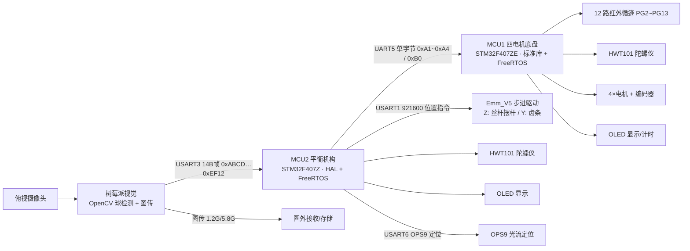
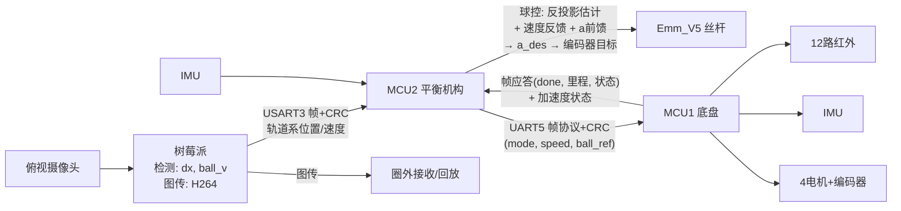

# 架构方案探索与比较

**项目**：2026 全国大学生电子设计竞赛 H 题「车载平衡滚球运动控制系统」
**范围**：整车系统拓扑、底盘循迹、摆杆驱动、球控算法、视觉、通信、RTOS 任务架构
**依据**：题面 PDF、`geometry.py`、`四电机底盘#mcu1`、`车载平衡机构#mcu2` 两套固件

---

## 0. 结论速览

当前"双 MCU + 树莓派视觉"的总体架构是**正确的基线**，不建议推倒重来。真正值得改的是三层：

1. **球控架构**：从"单环位置 PID → 角度"升级为"轨道系估计（反投影掉假速度）+ 速度反馈（`ball_v` 已传未用）+ 加速度前馈（`geometry.py` 闭式映射）"。
2. **底盘-球控协调**：底盘 200Hz 硬实时 + 球控事件驱动（相机帧到达即算），补上**底盘加减速对球的扰动前馈**。
3. **通信协议**：底盘链路由单字节命令升级为带 CRC8 的定长帧（`CRC8_CRC16.c` 已存在，可直接复用）。

驱动机构维持**丝杆步进**，但要把"每 30ms 发一次 stop→start"的阶梯式驱动改为**目标不变不重复发指令**，并实测丝杆动态速度上限是否满足 5s 往返（要求 3）。

---

## 1. 题目约束（决定架构空间的硬约束）

| 要求 | 分值 | 关键约束 | 对架构的直接影响 |
|---|---|---|---|
| 1 图传 | 6 | 发送模块在车上、接收模块在圈外，能回放 | 摄像头画面需同时用于检测与图传，或双摄 |
| 2 一圈≤20s、停车±2cm | 16 | 按键启动、计时显示 | 底盘需快速循迹 + 可靠停车判定 + 计时 |
| 3 球往返±5cm、≤5s、误差≤1cm | 13 | 静止状态 | 摆杆驱动**带宽**是关键，只涉及球控 |
| 4 A→B≤8s、球稳在中心±1cm | 20 | 底盘运动与球控**并行** | 双回路并行、底盘扰动补偿 |
| 5 一圈≤30s、球稳中心±1cm | 20 | 慢速行驶 + 球控 | 视觉精度与球控鲁棒性 |
| 6 一圈≤30s、球稳任意指定位置±1cm | 20 | 指定位置参考 | 球控需支持可变的参考位置 |
| 7 其他 | 5 | — | 加分项空间 |
| 8 设计报告 | 20 | 方案论证/理论分析/测试 | 本文档可直接作为方案论证素材 |

题面明确的两条**技术封锁**：

- 小车循迹模块**只能使用红外光电模块**（数量不限）→ 摄像头不能替代循迹，只能辅助停车/定位。
- 凹槽内钢球位置检测**必须采用摄像头** → 视觉检测不可省，且必须在车上。

机械上：摆杆为 25cm 4 分 PPR 水管凹槽、一端铰链、铰链端高度 h≥5cm、钢球直径约 1cm；车身 ≤35×25cm；自带电池。

---

## 2. 现状架构盘点（as-built）

### 2.1 硬件与系统拓扑

### 2.2 通信链路

| 链路 | 物理层 | 速率 | 协议现状 |
|---|---|---|---|
| 视觉 → MCU2 | USART3 | 默认 115200 | 14B 定长帧：帧头 0xABCD、帧尾 0xEF12、字节 2..10 校验和=字节 11；功能码 1=球位置 dx+ball_v，2=二维码，3=物料位，6=测试 |
| MCU2 → 视觉 | USART3 | 同上 | ASCII 指令串：ONE/TWO/THREE/FOUR/START/FINISH、偏移量数字串（标定/状态同步） |
| MCU2 → MCU1 | UART5 → USART3 | 115200 | **单字节命令**：0xA1 快速一圈 / 0xA2 A→B / 0xA3 慢速一圈 / 0xA0 停止；MCU1 回 0xB0 到位 |
| MCU2 → 步进 | USART1 | 921600 | Emm_V5 厂商协议：位置/速度/回零，读取位置 0x36 解包（addr 5=Z 丝杆，6=Y 齿条） |
| MCU2 → IMU | USART2 | 230400 | HWT101 帧 + DMA 空闲中断 |
| MCU2 → OPS9 | USART6 | 默认 | CRC8 校验帧 |
| MCU2 → G6220 | CAN1 | 1Mbps | 预留/备用（当前未用） |

### 2.3 软件架构

**MCU1（底盘）**：4 个 FreeRTOS 任务 + TIM6 200Hz（5ms）硬实时中断。

| 任务 | 优先级 | 周期 | 职责 |
|---|---|---|---|
| Task_ONE 显示 | 1 | 50ms | OLED：模式/指令/循迹偏差/Yaw/总里程/计时 |
| Task_TWO 按键 | 2 | 10ms | 按键直发运动指令（调试） |
| Task_THREE 路径状态机 | 3 | 1ms | 按 `mode` 查 `motion_paths`，逐条执行 STEP_FIXED_DIST / STEP_DIFF_TURN / STEP_SINGLE_SPEED，支持 skip_motor、action 回调、need_wait |
| Task_FOUR 通信+IMU | 4 | 1ms | HWT101 解算、串口命令解析（0xA0~0xA3）→ 切换 mode |
| TIM6 ISR | — | 200Hz | 读编码器速度、累计里程、循迹 P 控制（加权偏差 12 路）、加减速规划、Yaw 提前停 |

底盘运动 = **路径脚本**（`path_circle` / `path_AB` / `path_circle_slow`，脉冲值待标定）+ 循迹 PID 纠偏 + 里程/陀螺仪停止判定。快速模式无加减速，慢速模式带加速/减速段与转向增益缩放。

**MCU2（平衡机构）**：6 个 CMSIS-RTOS 线程。

| 任务 | 优先级 | 周期 | 职责 |
|---|---|---|---|
| UART_RX_TASK | 32 | 5ms 轮询 | 3 个队列：步进位置解包 / 视觉帧解析 / OPS9 |
| TOWER_TASK | 25 | 30ms | 球控：位置低通 → 误差 → 增量式 PID（积分分离、D 低通、死区、输出限幅）→ `beam_set_angle` |
| MAIN_TASK | 24 | 50ms | 比赛状态机：IDLE → RUNNING → DONE |
| CHASSIS_TASK | 16 | 10ms | 按键选模式、发底盘指令、偏移量选择、启动流程 |
| OUTPU_TASK | 8 | 100ms | OLED 状态显示 |
| defaultTask | 24 | 1ms | 占位 |

### 2.4 球控物理模型（`geometry.py`，架构的理论基石）

- 实心球沿斜面滚动为**纯双积分器**：`s̈ = (5/7)·g·sinθ`，无需小角近似。
- `sinθ = h/L`（丝杠高度 / 铰链到丝杠臂长）为精确几何关系 → **期望加速度 → sinθ → 编码器目标**是闭式换算（`accel_to_enc`）。
- 俯视相机测到的是水平投影 `x_cam = X_PIVOT − s·cosθ`：**倾角变化时球在画面里有"假速度"**，会被 PID 的 D 项当真实速度吃进去形成正反馈 → 必须在喂给估计器之前反投影（`unproject`）。
- 关键机械常量：转轴 +8cm、丝杠 −14cm（臂长 22cm）、镜头中轴 +0.7cm、螺距 0.8cm、编码器 65536/圈、sinθ 上限 0.30（≈17.5°）。

### 2.5 现状风险点

1. **球控是单环位置 PID**：`Tower_task` 只用 `dx`，视觉已经送来的 `ball_v` 未参与；对双积分对象 + 相机延迟 + 丝杆延迟，鲁棒性有限。
2. **假速度未反投影**：倾角变化时 D 项正反馈风险（`geometry.py` 已明确指出，但固件未实现）。
3. **底盘扰动无前馈**：车加速/减速/转弯时，摆杆参考系受惯性力扰动，球控没有任何补偿（要求 4/5/6 的隐患）。
4. **丝杆阶梯驱动**：`Tower_task` 每 30ms 无条件调 `beam_set_angle`，每次都"停止→发新位置指令"，丝杆实际在锯齿状运动，动态速度上限（500 RPM）下全行程约 0.33s，控制带宽被压低。
5. **底盘链路无校验**：单字节 0xA1~0xA4 / 0xB0，无帧结构、无状态、无参数，出错即丢指令（要求 2/4/5/6 都依赖这条链路）。
6. **帧率不同步**：球控固定 30ms 轮询，相机约 20fps，存在相位错拍；应改为帧到达事件驱动。
7. **两套换算基准不一致**：`geometry.py` 用 65536 计数/圈 + 螺距 0.8cm（8192 计数/mm）；`Controls.c` 用 Emm_V5 6400 脉冲/圈 + 导程 8mm（800 脉冲/mm）。需要以**实测**为准统一（闭式关系不变，只改常量）。
8. **路径参数待标定**：`path_circle` 等脉冲值标注"待标定"，A→B 路径还是 0。
9. **停车判定依赖单一手段**：目前靠里程 + Yaw<33° 提前停，停车±2cm 余量依赖标定精度；可增加启停线红外检测。

---

## 3. 分维度方案比较

### 3.1 处理器/系统拓扑

| 方案 | 描述 | 优点 | 缺点 |
|---|---|---|---|
| A 单 MCU | 底盘+球控+通信全放一块 F407 | 无板间延迟、布线少、成本低 | 循迹 200Hz 与球控 30Hz 争抢；外设不够（12 路 IR + 4 UART + 舵机/步进）；单点故障；两人无法并行开发 |
| B 双 MCU（现状） | 底盘 MCU + 平衡 MCU，视觉另用树莓派 | 时基完全解耦；外设充足；可并行开发；故障隔离；升级路径清晰 | 需设计板间协议与同步；多一层延迟（约 1ms，可接受） |
| C 三 MCU | 双 MCU 再拆出步进控制 | 步进实时性更独立 | 复杂度与成本上升，收益小；F407 完全够用 |

**结论**：维持 B。树莓派做视觉是合理分工——题面要求视频回传 + 摄像头检测，Linux 侧 OpenCV 开发效率远高于 MCU 侧。注意树莓派启动慢，比赛需提前开机或上电即启动。

### 3.2 底盘循迹与控制

循迹**只能用红外**，架构差异在"传感器布局 + 控制律 + 里程融合"。

| 方案 | 描述 | 优点 | 缺点 |
|---|---|---|---|
| A 纯红外 P 控制 | 12 路加权偏差 → 差速纠偏（现状快速模式） | 实现最简单、响应快 | 弯道丢线时无记忆；停车靠经验参数；加减速段速度冲击大 |
| B 红外 + 里程/陀螺仪融合（现状慢速模式） | 循迹纠偏 + 编码器里程 + Yaw 早停 + 加减速段 | 高速稳定、停车可重复、时间可控（20s/30s 限时） | 依赖标定；弯道内外轮速比需按 R=0.5m 几何预置 |
| C 纯航迹推算（死开环） | 路径脚本按脉冲走 | 完全离线可调 | 打滑/装配误差累积，2cm 停车必挂 |
| D 红外 + 里程 + 启停线检测 | 在 B 基础上增加"启停线"红外判停（题目允许红外数量不限） | 停车±2cm 的判定与里程解耦，更稳 | 多一路传感器与逻辑 |

**结论**：推荐 **B + D**：直道/弯道用红外循迹 + 里程分段，A 点停车用"启停线红外触发 + 里程冗余"双判据。路径脚本表本身没问题，但参数应通过一段标定脚本（可参考 `geometry.py` 的换算思路在车上做脉冲→cm 标定）生成，而不是手填。

### 3.3 摆杆驱动机构

| 方案 | 全行程响应 | 精度/回差 | 保持力矩 | 位置反馈 | 复杂度/成本 | 评价 |
|---|---|---|---|---|---|---|
| A 丝杆步进（现状） | 5°≈22mm，500RPM 下约 0.33s | 800 脉冲/mm 理论精度高，无回差 | 强，断电保持 | 绝对编码器（Emm_V5） | 中 | 精度与保持最佳；**带宽是瓶颈**，需实测动态速度 |
| B 舵机（云台/直线舵机） | 约 0.1~0.2s，快 | 有回差（金属齿小些），约 ±0.5° | 中，易抖动 | 电位器/无 | 低 | 适合要求 3 的快速往返，但保持稳定 ±1cm 与长时间循迹可能抖 |
| C 齿轮/齿条 + 直流电机 | 快 | 依赖编码器闭环 | 中 | 需外加编码器 | 中高 | 介于 A/B，机械改动大 |
| D 音圈/直线电机 | 最快 | 高 | 中 | 编码器 | 高 | 竞赛不现实 |

**结论**：维持 A（丝杆）。关键改进：

- `beam_set_angle` 改为**目标角度不变时不重发指令**（当前每 30ms 无条件 stop→start，等效把执行器带宽砍半以上）；
- 实测丝杆最大速度与加速时间，确认"5s 内 +5cm→−5cm 且稳态 ±1cm"（要求 3）的余量；不够则提高 `BEAM_SPEED_MAX` 或改用更高导程丝杆；
- 若要求 3 往返时间紧，可考虑"一次性发整段目标"让丝杆连续运动，而不是每帧重新规划。

### 3.4 球控算法架构

球是双积分器，摄像头是位置测量（延迟约 1~2 帧），丝杆是带饱和的执行器。这是典型的"二阶积分对象 + 大延迟 + 执行器限速"问题。

| 方案 | 结构 | 优点 | 缺点 |
|---|---|---|---|
| A 位置 PID→角度（现状） | error→PID→`beam_angle_to_pulse` | 实现最简单 | 无双积分补偿，稳态依赖积分；D 项吃假速度；速度反馈（`ball_v`）被丢弃 |
| B 串级 PID（位置环+速度环） | 外环位置→内环速度，`ball_v` 作速度反馈 | 阻尼好、抗噪声、不用 D 微分类 | 视觉速度噪声大，需滤波；仍需处理假速度 |
| C 模型前馈 + 反馈（`geometry.py` 闭式） | PD(a_des) → `sinθ_des` → 编码器，开环重力前馈 | 物理上精确：`a=(5/7)g·sinθ`、`sinθ=h/L` 均精确；执行器直接按"期望加速度"驱动，天然稳定 | 需要准确的几何标定（臂长、镜头偏置、水平零位）；前馈依赖 θ 响应快 |
| D 状态观测器 + LQR/极点配置 | 位置/速度观测（含假速度反投影）+ 最优反馈 | 理论上最完整，抗扰最好 | 开发与调试成本最高，竞赛时间风险大 |

**结论**：目标架构 = **B 的速度反馈 + C 的加速度前馈 + 反投影**：

1. 视觉端/MCU2 把 `dx` 经 `unproject` 还原为**轨道系真实位置**，速度用 `ball_v`（或差分+滤波）在轨道系估计；
2. 控制输出量纲从"角度"改为"期望加速度 a_des"；
3. `a_des → sinθ_des → 编码器目标` 用 `geometry.py` 的闭式换算，替代 `beam_angle_to_pulse` 的经验式；
4. 底盘 MCU 把实时加速度/转向状态发给 MCU2（或 MCU2 用 IMU 差分估计），作为**扰动前馈**叠加到 a_des。

这个方案的实现成本主要是标定与参数，代码量并不大，且 `geometry.py` 已经把数学全部写好了。

### 3.5 视觉与图传架构

| 方案 | 描述 | 优点 | 缺点 |
|---|---|---|---|
| A 树莓派 + OpenCV（现状） | 车上树莓派跑球检测 + 图传，USB/CSI 摄像头 | 开发快、帧率可控（20~30fps）、可同时做球位/二维码/物料；图传软件成熟（H264/RTSP） | 成本高、启动慢、功耗大；需固定曝光与 ROI |
| B OpenMV / K210 | 微型视觉板 | 便宜、秒启动、低功耗 | 算力小，球检测鲁棒性差；图传能力弱（需另加图传模块） |
| C 双摄 | 一颗给检测、一颗给图传 | 检测与图传互不干扰 | 重量/成本/标定增加；车身空间有限 |

**结论**：维持 A。要点：

- **固定曝光与白平衡**，避免赛场光线变化导致检测漂移；
- 标定流程已存在雏形（MCU2 发 ONE/TWO 等触发标定），应输出：ROI 与刻度线对齐、像素/mm 比例、镜头中轴偏置（`cam_axis_x_cm`）、水平零位；
- 球速 `ball_v` 已发送，帧率目标 ≥20fps，延迟尽量压到 1 帧；
- 图传与检测共用一帧画面即可，图传编码在树莓派侧，不影响 MCU。

### 3.6 通信协议架构

| 方案 | 描述 | 优点 | 缺点 |
|---|---|---|---|
| A 单字节命令（现状底盘链路） | 0xA1~0xA4 命令 + 0xB0 应答 | 极简、中断里直接判 | 无校验、无序列号、无参数（速度/距离/球参考）、无法传状态 |
| B 定长帧 + CRC8（推荐） | 帧头+命令+负载+CRC8+帧尾，如视觉链路风格 | 可传参数（目标速度/距离/球参考）、可扩展状态上报；`CRC8_CRC16.c` 已在工程里 | 需改造两处中断/解析 |
| C CAN 总线 | MCU2 已有 CAN1，需 MCU1 加收发器 | 抗干扰、仲裁 | 两点通信用 CAN 偏重；MCU1 无 CAN 模块，成本+布线 |

**结论**：底盘链路升级为 **B**：单字节命令保留作兼容入口，新增帧命令承载 `(mode, speed_scale, ball_ref, 急停)`，MCU1 应答帧携带 `(done, 里程, 状态)`。视觉链路已是 B 风格，保持即可。

### 3.7 RTOS 任务/时序架构

| 方案 | 描述 | 优点 | 缺点 |
|---|---|---|---|
| A 固定周期轮询（现状） | 球控 30ms、主状态机 50ms、显示 100ms | 简单、可预测 | 球控与相机 20fps 错拍；视觉帧到达后最多等 30ms 才处理 |
| B 事件驱动 | 视觉帧→信号量→球控立即执行；丝杆到位→事件 | 延迟最小，充分利用 20fps | 需处理多帧堆积（丢旧帧）；调试稍复杂 |
| C 混合（推荐） | 底盘 200Hz 保持硬实时中断；球控事件驱动；状态机/显示轮询 | 关键回路最优，非关键回路简单 | 需要定义好队列/信号量与超时 |

**结论**：MCU1 维持现状（TIM6 200Hz 硬实时 + 任务轮询，架构正确）。MCU2 的 TOWER_TASK 改为"等待视觉帧信号量"，其余任务不动。顺带把 `Tower_task` 里的 `osDelay(30)` 去掉，避免双时钟漂移。

---

## 4. 需求 → 架构映射矩阵

| 要求 | 关键架构决策 | 现状覆盖 | 主要风险 |
|---|---|---|---|
| 1 图传 | 树莓派视频编码 + 发射模块 | 有雏形（树莓派侧） | 图传带宽与检测共用；赛场电磁干扰 |
| 2 一圈 20s / 停车 2cm | 红外循迹 + 里程 + Yaw 早停 + 计时 | 已实现（参数待标定） | 停车判据单一；加减速段速度冲击 |
| 3 球往返 5s / ±1cm | 丝杆带宽 + 球控收敛速度 | 单环 PID，往返余量未知 | 丝杆 500RPM 全行程 ~0.33s；阶梯驱动拖慢 |
| 4 A→B 8s 球稳 ±1cm | 底盘-球控并行 + 扰动前馈 | 并行已具备；无扰动补偿 | 起步/停车加速度把球推走 |
| 5 一圈 30s 球稳中心 | 慢速圈 + 稳定球控 + 假速度反投影 | 慢速路径已有；算法缺反投影 | D 项正反馈；视觉噪声 |
| 6 任意指定位置 | 球控参考可配置 + 标定 | 有 target_ball_pos 与偏移量选择 | 刻度/镜头偏置标定精度 |
| 7 其他 | 预留（二维码/物料等） | 视觉功能码 2/3 已预留 | — |
| 8 报告 | 方案论证/理论分析 | 本文档 + geometry.py 可直接引用 | 需补实测数据 |

---

## 5. 推荐目标架构（演进而非重写）

实施路线（按风险从低到高）：

**短期（保底，1~2 天）**

1. `beam_set_angle` 目标不变不重发（去掉阶梯驱动）；
2. 球控加 `ball_v` 速度反馈（串级化），视觉已传数据直接可用；
3. 相机标定落地：像素/mm、镜头偏置、水平零位，写入配置；
4. 底盘路径参数用标定脚本生成。

**中期（主攻，3~5 天）**

5. 实现 `geometry.py` 的闭式映射（a_des→sinθ→编码器）替换经验换算，统一 800 脉冲/mm 与 8192 计数/mm 的基准；
6. 假速度反投影：估计器输入用轨道系位置而非画面坐标；
7. 底盘-球控帧协议升级（CRC8），并让底盘把加速度/转向状态反馈给球控做扰动前馈；
8. 球控改事件驱动（视觉帧到达即算）。

**长期（加分项）**

9. 状态观测器 + 最优控制；启停线辅助停车；要求 6 的指定位置参考预标定。

---

## 6. 待澄清/需实测的问题

1. **丝杆实际带宽**：`BEAM_SPEED_DYNAMIC` 下实测 5° 全行程时间与往复周期，判断要求 3 的 5s 余量。
2. **编码器基准统一**：ZDT 绝对编码器（65536/圈）与 Emm_V5（6400 脉冲/圈）哪套是实物？`geometry.py` 与 `Controls.c` 必须对齐。
3. **视觉帧率与延迟**：实测 20fps 下的端到端延迟（帧到 MCU2→丝杆动作），决定控制律带宽上限。
4. **停车判据**：现状"里程 + Yaw<33°"，建议加启停线红外冗余。
5. **球控参考标定**：要求 6 的"任意指定位置"需要刻度 ↔ 画面坐标 ↔ 轨道坐标的完整标定链。

---

## 附：关键参数速查（来自代码）

| 参数 | 值 | 来源 |
|---|---|---|
| MCU1 / MCU2 | STM32F407ZETx / STM32F407Z(E-G)Tx | uvprojx / .ioc |
| 底盘控制周期 | TIM6 200Hz（5ms） | Encoder.c |
| 循迹传感器 | 12 路红外，PG2~PG13，加权 ±5.5 | Gray.c |
| 底盘-球控链路 | UART5→USART3，115200，0xA0~0xA4 / 0xB0 | Serial.c / TJC.c |
| 视觉帧 | 14B，0xABCD / 0xEF12，校验和 | Serial.h |
| 球控周期 | 30ms，PID kp0.03 ki0.01 kd0.25，输出限幅 ±5° | Tower_task.c |
| 丝杆 | 导程 8mm，6400 脉冲/圈 → 800 脉冲/mm，动态 100~500RPM | Controls.h |
| 摆杆 | 长 250mm，角度限幅 ±5°，`pulse = 250·tan(θ)·800` | Controls.c |
| 物理模型 | `s̈=(5/7)g·sinθ`，`sinθ=h/L`，臂长 22cm，sinθ 上限 0.30 | geometry.py |
